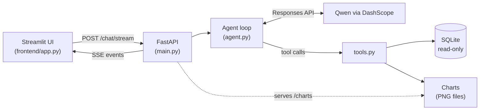
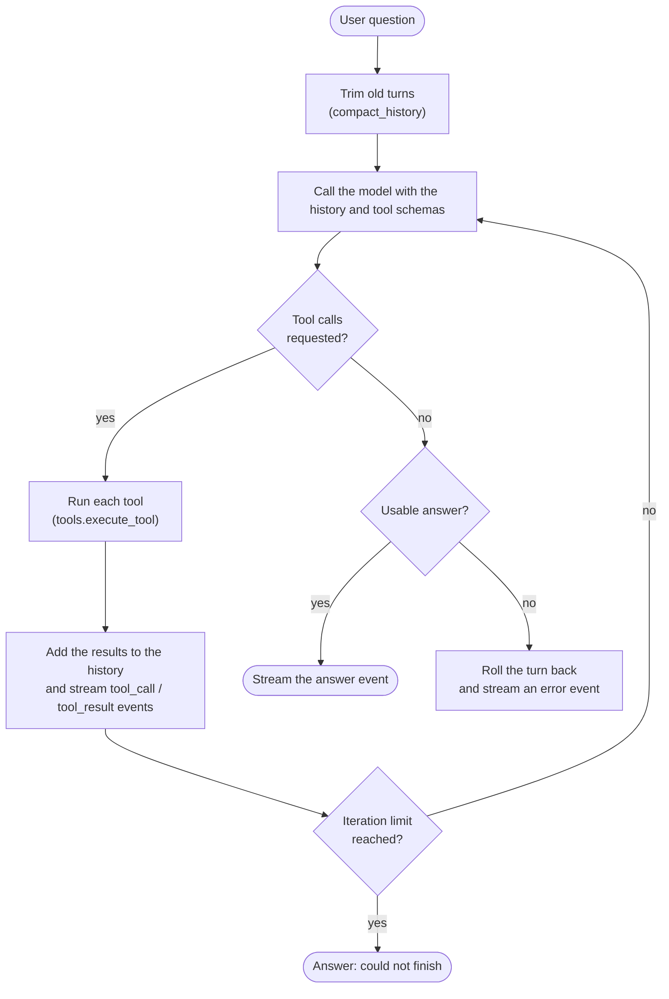

# Data Analyst Agent

Ask questions about a sales database in plain English and get answers and charts back. You can watch the agent work: its thinking steps and every tool call stream into the UI as they happen.

The agent loop is written by hand on the plain `openai` SDK (no LangChain or other agent frameworks). It talks to Alibaba Cloud DashScope (Qwen) through the Responses API.



## Features

- Answers questions about the Superstore sales data (2014–2017, 9,994 order lines) with SQL it writes itself.
- Draws bar, line, pie, scatter and histogram charts on request.
- Live view of thinking, SQL and results, including failed calls and the agent correcting itself.
- Database access is read-only, enforced twice (see [Safety](#safety)).
- Tests use a scripted fake model, so they make no network calls.

## Quick start

You need an API key for DashScope (or any OpenAI-compatible endpoint that supports the Responses API).

```powershell
copy .env.example .env      # then fill in DASHSCOPE_API_KEY, LLM_BASE_URL, LLM_MODEL
```

### With Docker

```powershell
docker compose up --build
```

- UI: http://localhost:8501
- API: http://localhost:8000 (`/health`, `/docs`)

The database is built from `data/` while the image is built.

### Without Docker

```powershell
python -m venv backend\.venv
backend\.venv\Scripts\Activate.ps1
pip install -r requirements.txt
python backend/app/scripts/load_csv.py          # build backend/sample.db from the CSV

cd backend; uvicorn app.main:app --reload       # terminal 1: the API (run from backend/)
streamlit run frontend/app.py                   # terminal 2: the UI (from the repo root)
```

Or chat in the terminal, with live LLM calls and every tool call printed:

```powershell
cd backend; python -m app.agent "Total sales by region"
```

Try asking: *Total sales by region*, *Monthly profit in 2016 as a line chart*, *Top 5 products by profit*.

## Configuration

Settings are read from a root-level `.env` (see `.env.example`).

| Variable | Required | Default | Meaning |
|---|---|---|---|
| `DASHSCOPE_API_KEY` | yes | | API key |
| `LLM_BASE_URL` | yes | | OpenAI-compatible endpoint with Responses API support |
| `LLM_MODEL` | yes | | Model name, e.g. a Qwen model |
| `DB_PATH` | no | `sample.db` | SQLite file; relative paths resolve against `backend/` |
| `LLM_ENABLE_THINKING` | no | `true` | Ask Qwen for reasoning summaries (shown as 💭 in the UI) |
| `LLM_TIMEOUT_S` | no | `60` | Timeout per LLM call |

The Streamlit app reads `API_URL` (default `http://127.0.0.1:8000`) to find the API.

## API

| Endpoint | Description |
|---|---|
| `GET /health` | Liveness check |
| `POST /chat` | `{session_id, message}` → `{answer, chart_urls}` after the whole turn |
| `POST /chat/stream` | Same body; streams the turn as Server-Sent Events |
| `DELETE /chat/{session_id}` | Forget a session's history |
| `GET /charts/<file>.png` | Rendered charts |

`/chat/stream` sends one JSON object per `data:` line:

```
{"type": "thinking",    "text": "..."}
{"type": "tool_call",   "id": "...", "name": "run_sql", "arguments": {...}}
{"type": "tool_result", "id": "...", "ok": true, "output": "...", "chart_url": null}
{"type": "answer",      "text": "...", "chart_urls": ["/charts/abc.png"]}   // last on success
{"type": "error",       "message": "..."}                                    // last on failure
```

```powershell
curl -N -X POST localhost:8000/chat/stream -H "content-type: application/json" `
     -d '{\"session_id\":\"demo\",\"message\":\"Total sales by region\"}'
```

## How it works



1. `main.py` keeps one history list per `session_id` (in memory) and calls `agent.run_stream`.
2. `agent.py` loops: call the model, add everything it produced to the history, run each requested tool, send the results back, and stop when the model answers without a tool call (at most `MAX_ITERATIONS` rounds). Each step is yielded as an event.
3. `tools.py` runs tools and turns every failure into an `Error: ...` string, so the model can read the message and retry.
4. `run_sql` keeps the full result in a cache and sends the model only a short preview plus a `result_id`. `make_chart` takes that `result_id`, so large data never enters the model's context.
5. If a turn fails or the stream is closed early, its partial items are removed from the history, because a `function_call` without an output would break every later call.
6. Old reasoning items and long tool outputs are trimmed at the start of each turn to keep long conversations inside the context window.

## Safety

- **Read-only database, two layers.** A SQLite authorizer allows only `SELECT`, `READ`, `FUNCTION` and `RECURSIVE` operations, so INSERT, UPDATE, DELETE, DDL, PRAGMA and ATTACH are refused however the SQL is written (comments, quoting, `WITH ... DELETE`). The connection itself is opened with `mode=ro` and `PRAGMA query_only=ON`.
- Queries are limited to `MAX_ROWS` rows and `QUERY_TIMEOUT_S` seconds.
- Every tool call is printed to the console and logged, so runs can be audited.

## Project layout

```
backend/app/
  main.py         FastAPI app, sessions, SSE endpoint
  agent.py        the agent loop (run_stream / run) and system prompt
  llm.py          OpenAI SDK client for DashScope (Responses API)
  tools.py        tool JSON schemas, dispatch, error handling
  tool_impl.py    tool bodies: list_tables, describe_table, run_sql, make_chart
  db.py           read-only SQLite access (authorizer + ro connection)
  results.py      in-memory cache of query results
  charts.py       matplotlib chart rendering
  stub_stream.py  fake event source, used only if agent.run_stream is missing
  scripts/load_csv.py   build sample.db from the CSV
backend/tests/    pytest suite with a scripted fake model
backend/evals/    eval set (cases.json) and runner against the live agent
frontend/app.py   Streamlit UI
data/             the Superstore CSV
```

## Tests

```powershell
pip install -r requirements-dev.txt
cd backend; python -m pytest
```

## Evals

`backend/evals/cases.json` holds questions with checks graded against the real database (each check carries its own gold SQL). The runner calls the agent directly, so it makes live LLM calls and is slow and not free:

```powershell
cd backend
python -m evals.run --repeat 3                   # every case, 3 runs each: shows flaky cases
python -m evals.run --only profit-2016 --quiet   # one case; keep tool-call prints out of the console
python -m evals.run --tag trap
```

Tags `injection` (prompt-injection attempts typed by the user or hidden in the data) and `scope` (off-topic questions) test safety and behaviour; injection cases against hidden instructions use a poisoned copy of the database that is built automatically. It prints pass counts per case and per tag, lists why each failure failed, and saves everything to `backend/evals/results/` (gitignored). To add a case, append to `cases.json`; the check types are described at the top of that file.

## Limitations

This is a learning project built for one user at a time:

- Sessions and the results cache live in memory and are lost when the server restarts.
- Chart rendering and the cache are not thread-safe, sessions are never evicted, and chart PNGs are never deleted.
- There is no authentication.

Revisit these before serving several users.

## Data

`data/e commerce dataset (2).csv` is the Superstore sales sample. The loader converts dates to `YYYY-MM-DD`, renames columns to snake_case and stores `postal_code` as 5-character text. Quirks are left in on purpose: `profit` can be negative, and 32 `product_id`s map to more than one `product_name`.
